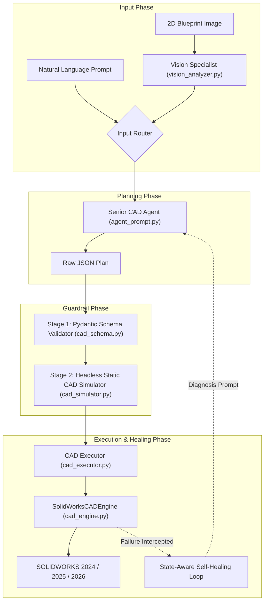

# SolidAI System Architecture & Engineering Reference

This document provides a comprehensive technical breakdown of **SolidAI**, detailing its layered architecture, coordinate systems, COM API bindings, self-healing pipeline, and blueprint vision analyzer.

---

## 1. Architectural Philosophy

Traditional attempts at AI-driven CAD fail for three main reasons:
1. **Unbounded Code Generation**: Asking an LLM to generate raw VBA macros or C# scripts results in syntax errors, unhandled COM exceptions, and unpredictable geometry.
2. **Unit & Orientation Mismatches**: SOLIDWORKS COM API requires dimensions in **meters** internally, angles in **radians**, and handles coordinate frames in 3D world space rather than 2D sketch space.
3. **Lack of Closed-Loop Feedback**: If a sketch contour is open or self-intersecting, standard scripts fail silently without reporting the geometric cause.

**SolidAI** solves these problems via a **Declarative Parametric Action Plan Architecture**:
- The AI never writes raw API code; it outputs an unambiguous, structured **JSON CAD Action Plan**.
- A dedicated, hardened engine (`SolidWorksCADEngine`) handles all unit conversions, coordinate mappings, and COM error handling.
- A multi-stage validation pipeline ensures that no invalid plan ever reaches SOLIDWORKS.

---

## 2. Layered Pipeline

---

## 3. Coordinate System & Unit Transformation

### 3.1 Units
- **Input Parameters**: SolidAI accepts all lengths in **millimeters ($mm$)** and all angles in **degrees ($^\circ$)**.
- **Internal API**: The engine translates all dimensions to **meters ($m$)** by dividing by $1000.0$, and all angles to **radians** via `math.radians()`.

### 3.2 2D Sketch to 3D World Mappings

When creating sketches on standard datum planes, coordinates map as follows:

| Standard Plane | Sketch Coordinate $(u, v)$ | 3D World Coordinate $(X, Y, Z)$ |
| :--- | :--- | :--- |
| **Front Plane** (`on` / `front`) | $(+u, +v)$ | $(+X, +Y, 0)$ |
| **Top Plane** (`ust` / `top`) | $(+u, +v)$ | $(+X, 0, -Z)$ |
| **Right Plane** (`sag` / `right`) | $(+u, +v)$ | $(0, +Y, -X)$ |

### 3.3 Rotated Profile Mathematics (`draw_rotated_rectangle`)

To circumvent SOLIDWORKS's axis-alignment restriction with standard center rectangles, SolidAI employs a direct trigonometric vertex generator:

$$\begin{aligned}
u_x &= \cos(\alpha) \cdot \frac{L}{2}, \quad u_y = \sin(\alpha) \cdot \frac{L}{2} \\
v_x &= -\sin(\alpha) \cdot \frac{W}{2}, \quad v_y = \cos(\alpha) \cdot \frac{W}{2}
\end{aligned}$$

Four corner vertices are evaluated in world space:
$$\begin{aligned}
P_1 &= (c_x + u_x + v_x, \; c_y + u_y + v_y) \\
P_2 &= (c_x - u_x + v_x, \; c_y - u_y + v_y) \\
P_3 &= (c_x - u_x - v_x, \; c_y - u_y - v_y) \\
P_4 &= (c_x + u_x - v_x, \; c_y + u_y - v_y)
\end{aligned}$$
These vertices are connected sequentially via `SketchManager.CreateLine` to produce closed, unconstrained profiles ready for extrusion.

---

## 4. Guardrail & Verification Stages

### Stage 1: Pydantic Schema Validation (`cad_schema.py`)
- Enforces strict typings for all 36 operations.
- Validates parameter limits ($dia > 0$, $depth\_mm > 0$).
- Supports full bilingual alias resolution (`part_name` $\leftrightarrow$ `parca_adi`, `action` $\leftrightarrow$ `islem`).

### Stage 2: Headless Static Dry-Run Simulator (`cad_simulator.py`)
- Analyzes sketch lifecycle before touching COM:
  - Detects if an entity is drawn without an active sketch.
  - Verifies that `revolve_boss` has a corresponding `draw_centerline`.
  - Flags overlapping disparate contours that would cause multi-body fragmentation.

### Stage 3: Live Post-Step State Verification
- After every 3D operation, `cad_engine.py` inspects:
  - `body_count`: Ensures that additions do not create disconnected floating bodies and cuts do not split the model.
  - `volume_mm3`: Verifies that `extrude_boss` increases volume and `extrude_cut` removes material.
  - Feature error codes via `feat.GetErrorCode2()`.

---

## 5. Headless Mock Engine (`mock_engine.py`)

For CI/CD and environments without SOLIDWORKS installed, `MockCADEngine` mirrors the exact interface of `SolidWorksCADEngine`. It computes:
- Exact 2D polygon shoelace area:
  $$A = \frac{1}{2} \left| \sum_{i=0}^{n-1} (x_i y_{i+1} - x_{i+1} y_i) \right|$$
- Exact cylindrical and circular pattern volumes.
- Revolution volume integration for stepped rotational parts.
- State-aware bounding box calculations.

---

## 6. Vision Blueprint Analyzer (`vision_analyzer.py`)

The blueprint analyzer utilizes high-resolution multimodal models (Google Gemini 2.5 Flash / Pro) configured with strict mechanical drawing prompts:
1. **Multi-View Decomposition**: Identifies Front, Top, and Side projections.
2. **Datum & Axis Detection**: Establishes primary rotational axes and planar base faces.
3. **Tolerance & Bore Verification**: Extracts hole patterns, keyways, and counterbores.
4. **Iterative Visual Repair**: If a generated model differs from the drawing, the visual agent captures an isometric render from SOLIDWORKS and adjusts sketch dimensions.
