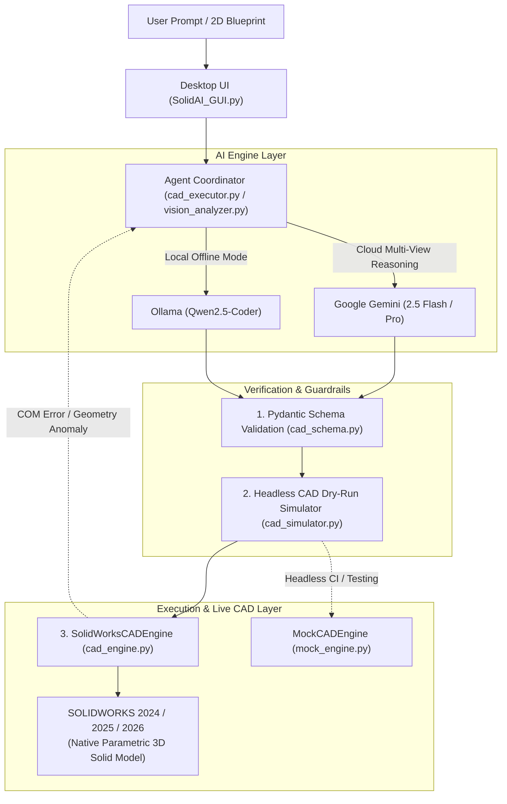

# SolidAI — Autonomous Parametric CAD Agent for SOLIDWORKS

[](https://www.python.org/downloads/)
[](https://www.solidworks.com/)
[](LICENSE)
[]()
[-purple.svg)]()

> **SolidAI** is an autonomous, state-aware parametric CAD engineering agent that transforms natural language engineering prompts and 2D blueprints into native, parametric **SOLIDWORKS 3D CAD models** via the Windows COM API.

---

## 🌟 Key Capabilities

- **💬 Natural Language to 3D CAD**: Convert mechanical design prompts (*"Design a lightweight robot arm articulation link with weight-reduction pockets, mounting holes, and chamfers"*) into fully featured SOLIDWORKS models.
- **📐 2D Blueprint Vision to 3D CAD**: Extract dimensions, datum faces, multi-view projections (Front, Top, Section), and tolerances from raster technical drawings (`.png`, `.jpg`, `.bmp`) to reconstruct 3D geometry.
- **🌐 Hybrid AI Architecture**: Seamlessly switch between **Google Gemini** (Gemini 2.5 Flash / Pro) for advanced multi-view blueprint reasoning and **Ollama / Qwen2.5-Coder** for 100% offline local privacy.
- **🛡️ 3-Stage Closed-Loop Self-Healing**:
  1. **Strict Pydantic Schema Validation**: Structural syntax enforcement before execution.
  2. **Headless Python CAD Simulator**: Static collision, contour overlap, and centerline verification.
  3. **Live State-Aware Error Recovery**: If SOLIDWORKS returns a COM error or geometric anomaly, SolidAI intercepts the error code, reports feature state back to the LLM, and repairs the plan on a clean document.
- **🧪 Headless CI/CD Testing Suite**: Complete in-memory `MockCADEngine` allowing full benchmark evaluation without requiring a SOLIDWORKS license or Windows COM runtime.

---

## 🏗️ System Architecture



---

## 🚀 Quick Start

### 1. Prerequisites
- **Operating System**: Windows 10 / 11 (64-bit)
- **CAD Environment**: SOLIDWORKS 2024, 2025, or 2026 installed and activated
- **Python**: Python 3.10 or higher
- *(Optional)* **Ollama**: For 100% offline local model inference ([ollama.com](https://ollama.com))

### 2. Installation

Clone the repository and install dependencies:

```bash
git clone https://github.com/YourUsername/SolidAI.git
cd SolidAI
pip install -r requirements.txt
```

### 3. Configuration

Copy the example configuration file:

```bash
cp config.example.json config.json
```

Edit `config.json` (or enter your key directly inside the GUI):

```json
{
  "GEMINI_API_KEY": "YOUR_GEMINI_API_KEY_HERE"
}
```

> **Security Note**: `config.json` is protected by `.gitignore` and will never be committed to Git.

### 4. Launching SolidAI

Ensure SOLIDWORKS is open, then launch the agent:

```bash
# Using the portable batch launcher
start_solidai.bat

# Or run directly with Python
python SolidAI_GUI.py
```

---

## 📖 How to Use Manual (User Guide)

SolidAI is designed with an intuitive dual-mode workflow that allows mechanical engineers and designers to move from concept to CAD in seconds.

### Mode 1: Natural Language CAD (Text to 3D Model)

1. **Launch the Application**: Run `start_solidai.bat` or `python SolidAI_GUI.py`.
2. **Select AI Engine**:
   - `🌐 Hybrid (Google Gemini)`: Cloud-connected reasoning with high dimensional precision and creative geometry optimization.
   - `💻 Local (Ollama / Qwen2.5-Coder)`: Runs 100% locally on your machine with zero API cost and full data privacy.
3. **Select Design Style & Creativity**:
   - `🏎️ Aerospace & Racing`: Automatically directs the AI to design lightweight parts featuring pocketing, weight-reduction cavities (`draw_lightening_pocket`), stiffening ribs (`draw_stiffening_rib`), and edge chamfers.
   - `🏭 Industrial & Heavy-Duty`: Generates rigid, thick-walled parts optimized for heavy machining, welding, or casting.
   - `📐 Minimalist & Standard`: Constructs exact, direct geometric shapes matching standard geometric dimensions without decorative features.
4. **Enter Your Design Requirements**:
   - Type your mechanical requirements into the prompt box (e.g., *"Design an L-bracket for a NEMA 17 motor with 31 mm mounting pattern, 22 mm center bore, and 4 mm wall thickness"*).
   - Or click any of the **Quick Engineering Templates** at the bottom to pre-fill verified mechanical parts (flanges, shafts, brackets, drone frames, pillow blocks).
5. **Generate**:
   - Click **`🚀 Generate Parametric CAD in SOLIDWORKS`**.
   - SolidAI will synthesize the multi-step parametric action plan, execute a dry-run simulation, and stream the commands into SOLIDWORKS.
   - Within seconds, your 3D model will appear centered and zoomed-to-fit on the SOLIDWORKS viewport!

---

### Mode 2: Blueprint to 3D CAD (Technical Drawing Vision)

1. **Switch to Tab 2**: Click on the **`📐 Blueprint to 3D CAD`** tab at the top of the window.
2. **Select Technical Drawing Image**:
   - Click **`📁 Select Blueprint / Drawing (.png, .jpg, .bmp)`**.
   - Choose a photo, scan, or raster image of an engineering drawing or blueprint.
   - A thumbnail preview with dimensions and file size will appear on screen.
3. **Add Engineering Directives (Optional)**:
   - In the notes text box, enter any specific instructions (e.g., *"Ensure center bore has H7 tolerance, cut M10 tapped holes at corners"*).
4. **Enter Gemini API Key**:
   - Provide your Google Gemini API key in the password field (saved securely in your local session).
5. **Generate from Blueprint**:
   - Click **`🚀 Generate 3D CAD from Blueprint`**.
   - The Vision Specialist decomposes the drawing into Front, Top, and Section views, resolves dimensions, builds the parametric feature tree, and models the part in SOLIDWORKS.

---

### 💻 Local Offline Setup (Ollama)

If you prefer to run SolidAI without an internet connection or external API keys:

1. Download and install Ollama from [ollama.com](https://ollama.com).
2. Pull the optimized coder model:
   ```bash
   ollama pull qwen2.5-coder:7b
   ```
3. SolidAI's `start_solidai.bat` will automatically start the background Ollama service if it is not already running.
4. In the GUI, select `💻 Local (Ollama / Qwen2.5-Coder)` as the AI Engine.

---

### ❓ Troubleshooting & FAQs

- **SOLIDWORKS Connection Issues**:
  - Ensure SOLIDWORKS is running before clicking Generate. SolidAI connects via Windows COM (`win32com.client.Dispatch("SldWorks.Application")`).
  - If you see a COM error, restart SOLIDWORKS and run `start_solidai.bat`.
- **What happens if a feature fails?**:
  - SolidAI features an automated **Self-Healing Loop**. If an extrusion or cut encounters a geometric collision or fails in SOLIDWORKS, SolidAI intercepts the exact COM error code and model state, feeds it back to the AI planner, and regenerates a repaired plan on a fresh part document.
- **Quota Limits on Free Gemini API**:
  - If a model reaches the free-tier rate limit (HTTP 429), SolidAI automatically falls back through its frontier candidate pool (`gemini-3-flash-preview` $\rightarrow$ `gemini-3.8-flash` $\rightarrow$ `gemini-3.7-flash` $\rightarrow$ local Ollama) without crashing.

---

## 📁 Repository Structure

```
SolidAI/
├── SolidAI_GUI.py            # Modern dark-themed Tkinter GUI (Dual Tab: Prompt & Blueprint)
├── cad_engine.py             # SolidWorksCADEngine: COM API wrapper, unit conversion, 2D/3D operations
├── mock_engine.py            # MockCADEngine: Pure-Python headless in-memory CAD engine for CI/testing
├── cad_executor.py           # Execution engine, streaming, closed-loop self-healing loop
├── cad_schema.py             # Pydantic schema validation & bilingual action mapping
├── cad_simulator.py          # Static dry-run simulator & contour overlap detector
├── agent_prompt.py           # Senior Mechanical Engineer system prompts & few-shot library
├── vision_analyzer.py        # Technical drawing blueprint vision analyzer & prompt compiler
├── parametric_templates.py   # Verified mathematical templates (flanges, shafts, brackets, frames)
├── settings.py               # Safe configuration manager for API keys & model endpoints
├── start_solidai.bat         # Portable launcher script (%~dp0)
├── config.example.json       # Sanitized configuration template
├── requirements.txt          # Python runtime dependencies
├── LICENSE                   # MIT License
├── ARCHITECTURE.md           # In-depth architectural specification and API reference
├── eval/                     # Benchmark suite and automated evaluation tools
│   ├── run_benchmark.py      # Automated 9-case benchmark with fault injection tests
│   └── test_cases.json       # Benchmark geometric specifications
└── tools/                    # Diagnostic and audit utilities
    ├── audit_codebase.py     # Signature verification and API consistency checker
    └── api_probe.py          # Live Gemini and Ollama model endpoint tester
```

---

## 📊 Verification & Benchmark Suite

SolidAI features a built-in automated test suite measuring volumetric accuracy, body integrity, and fault injection defenses:

```bash
python eval/run_benchmark.py
```

### Benchmark Results (100% Pass Rate)

| Test Case | Description | Geometric Target | Status |
| :--- | :--- | :--- | :---: |
| **CASE_1** | 6-Hole Standard Pipe Flange | Single solid body, 6x PCD holes | ✅ PASS |
| **CASE_2** | NEMA 17 Stepper Motor L-Bracket | Slotted base, 31 mm motor pattern | ✅ PASS |
| **CASE_3** | 3-Step Rotational Transmission Shaft | Multi-step concentric body, chamfers | ✅ PASS |
| **CASE_4** | Pillow Block Bearing Housing | Bottom slot, central bearing bore, rib | ✅ PASS |
| **CASE_5** | Stepped Bearing Block (M10 Threaded) | Tapped corner holes, cylindrical hub | ✅ PASS |
| **CASE_6** | Shift Fork & Clevis Linkage (Drawing 36) | Crescent fork body, pin hole, slot | ✅ PASS |
| **CASE_7** | Quadcopter 240 mm X-Frame Chassis | Diagonal arms, motor beds, slots | ✅ PASS |
| **FAULT_1** | Unknown Operation Injection | Caught by Pydantic schema | ✅ PROTECTED |
| **FAULT_2** | Empty Sketch Extrusion Injection | Caught by static CAD simulator | ✅ PROTECTED |
| **FAULT_3** | Revolve Without Centerline Injection | Caught by static CAD simulator | ✅ PROTECTED |

---

## 🛠️ API & Operational Support

SolidAI supports 36+ verified parametric operations including:

- **Planes & Faces**: `select_plane`, `select_face`, `select_top_face`, `select_face_by_ray`, `create_ref_plane`, `select_ref_plane`
- **2D Sketching**: `draw_circle`, `draw_center_rectangle`, `draw_corner_rectangle`, `draw_rotated_rectangle`, `draw_polygon`, `draw_slot`, `draw_line_chain`, `draw_centerline`, `draw_circular_hole_pattern`, `draw_rectangular_hole_pattern`
- **3D Features**: `extrude_boss`, `extrude_cut`, `revolve_boss`, `revolve_cut`, `apply_chamfer`, `apply_fillet`, `create_hole_wizard`, `circular_pattern_last_feature`, `shell_body`

Full API documentation and coordinate transform details can be found in [ARCHITECTURE.md](ARCHITECTURE.md).

---

## 🤝 Contributing

Contributions are welcome! Please review [CONTRIBUTING.md](CONTRIBUTING.md) for pull request guidelines, coding standards, and testing procedures.

---

## 📄 License

This project is licensed under the MIT License - see the [LICENSE](LICENSE) file for details.
